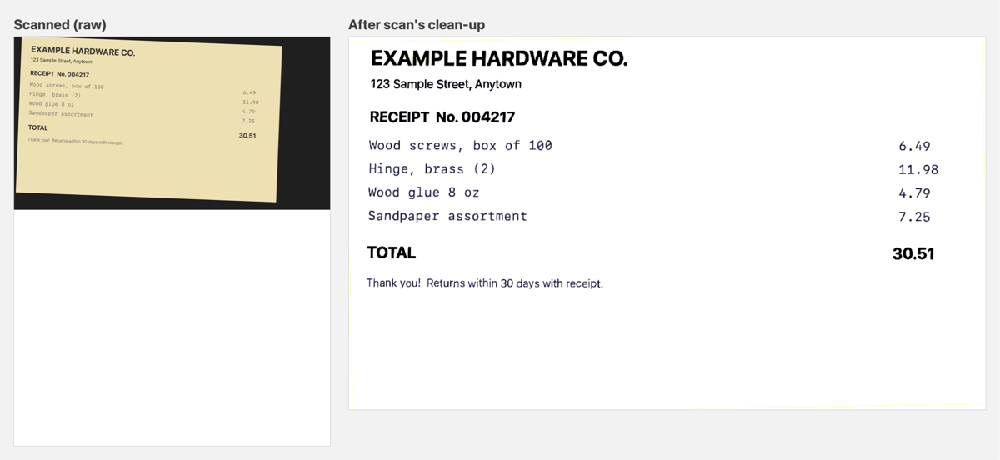

# epson-es50-cli

`scan`: a macOS command-line tool for the Epson ES-50 sheet-fed scanner, with no Epson software
needed. It scans to PDF/JPEG/PNG; straightens, crops and cleans pages (white paper, crisp text,
faint ink kept); cuts small receipts and slips out of the scanner background; and scans long
documents up to 72" (dot-matrix printouts, contracts) through a patched SANE driver.

*Sample receipt made up for this picture: raw scan on the left, `scan`'s output on the right.*

Tested only on the Epson ES-50. Other Epson scanners that SANE's `epsonds` backend supports
(ES and DS series) may work, but are untested.

## Requirements

- macOS 12 or later (Vision document detection); tested on macOS 27
- Xcode command-line tools (`xcode-select --install`) for `swiftc`
- Homebrew, used by `sane/build.sh` for libusb, jpeg-turbo and SANE's source

## Setup

    sane/build.sh         # builds the patched SANE driver into ~/.local/share/scan/sane
    make install          # builds and installs to ~/.local/bin/scan

## Usage

    scan info             # show scanner capabilities
    scan                  # one page -> ./scan-<time>.pdf in the current folder
    scan -b bills.pdf     # feed page 1 first, face up, top edge first; Enter when done
    scan -m gray -r 200 note.jpg
    scan clean old.pdf    # straighten/clean an existing scan -> old-clean.pdf
    scan -l contract.pdf  # long document (up to 72") as one tall page; --split for 11" pages

Pages are cropped to the sheet, turned upright, straightened and cleaned up
(white paper, darker text); blank pages are dropped. `--raw` turns this off,
`--keep-blank` keeps blank pages.

Long printouts (`-l`): tear off the tractor-hole strips (max width 8.5"), feed up
to 72" (6 pages) per stretch, top edge first, guiding the paper by hand. The
unused tail is trimmed and it is saved as one tall page. `--split` (or
`--page-length N`) cuts it into pages at the gap nearest every 11" (or N"). `--greenbar` removes green/blue bar stripes from computer printouts,
but also fades blue or coloured ink, so use it only on greenbar paper.

Sheets smaller than the scan area (receipts, slips, tear-off forms) are cut out of the scanner
background, straightened, and any dark backing left along the edges is painted white.

Clean-up sharpens normal pages (SANE returns the sensor image unsharpened). Faint dot-matrix or
carbon text gets a softer recipe that joins the dots instead: on by default with `--long`, or
force it with `--faint` / `--no-faint`.

The ES-50 takes paper up to 72", but Image Capture and stock SANE stop at 14".
`sane/build.sh` builds SANE's epsonds backend with `sane/epsonds-long-paper.patch`
(it lets the scan area use the scanner's reported maximum, `#ADF AMAX`) into
`~/.local/share/scan/sane`. When that build exists, all scans go through it and no Epson software is
needed: `sudo sh sane/remove-epson.sh` lists Epson's scanner software and
`--yes` removes it. Without the build, scan falls back to Image Capture, which
needs Epson's ICA driver and stops at 14".

Run `scan --help` for all options.

## Removing Epson's software (optional)

`sane/remove-epson.sh` deletes Epson Scan 2, its Image Capture driver, ScanSmart, Event
Manager and related files with sudo. It is written for the ES-50 (driver `ES017E`); check the
list before removing anything. Run it without `--yes` first: it only prints what it would
remove. After removal, scan only works through the patched SANE build.

## License

MIT, except `sane/epsonds-long-paper.patch`, which is GPL-2.0-or-later like the SANE code it
changes (see `sane/LICENSE`). See `LICENSE`.
